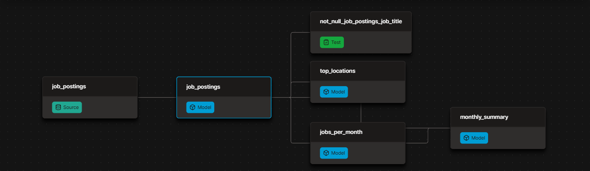

# Automated Job Market Pipeline | dbt & DuckDB

[](https://github.com/Nero103/dbt-duckdb-datapipeline/actions/workflows/dbt_build.yml)


A public dbt and DuckDB pipeline over 692k real job postings, rebuilt and republished automatically on every push.

- Models the raw postings into tested and documented insight marts
- Publishes the docs site and the finished warehouse, open to anyone, no credentials needed
- Runs itself on GitHub Actions with every push and every Monday

> **V1 of this pipeline**: everything free and local-friendly with DuckDB as the warehouse and GitHub Actions as the scheduler. [V2](../project_2/) will rebuild a production-grade on Databricks.

| What I Built | How I Implemented | Where to Look |
| --- | --- | --- |
| **dbt pipeline** | sources → cleaned model → insight marts | [`analytics/models/`](analytics/models/) |
| **Data tests** | `unique` / `not_null` on every mart grain | [`schema.yml`](analytics/models/schema.yml) |
| **Hosted dbt docs** | lineage, descriptions, column tests | [Live docs site](https://nero103.github.io/dbt-duckdb-datapipeline/) |
| **Public CI** | build + test + publish on every push | [Actions workflow](https://github.com/Nero103/dbt-duckdb-datapipeline/actions/workflows/dbt_build.yml) |
| **Environments** | local `dev` vs CI `prod` targets | [`ci/profiles.yml`](ci/profiles.yml) |
| **Published warehouse** | one `ATTACH`, queryable by anyone | [Query it](https://github.com/Nero103/dbt-duckdb-datapipeline/releases/download/warehouse/prod.duckdb) |

---

## ⚙️ The dbt Pipeline

Raw postings flow through three dbt layers: declared sources → cleaned staging views → insight marts, with tests checking every build. The DAG below is the whole flow:



Also, the dbt features doing the work:

| dbt Feature | How I Used It |
| --- | --- |
| Declared sources (no hardcoded paths in SQL) | [`sources.yml`](analytics/models/sources.yml) + `source('raw', 'job_postings')` |
| Model dependencies | `ref()` everywhere downstream; dbt resolves order and parallelism |
| Materializations | project default `table`; staging override to `view` |
| Data tests | `unique` / `not_null` on mart grains in [`schema.yml`](analytics/models/schema.yml) |
| Environments | local `dev` vs CI `prod` targets ([`ci/profiles.yml`](ci/profiles.yml)) |

`dbt build` compiles SQL, materializes models, and fails the run if any test fails — same command locally and in CI.

**Independent SQL Enhancement:** Extended the `monthly_summary` model with `COALESCE()` and `NULLIF()` to handle missing values from joins, prevent division by zero errors, and improve the reliability of monthly remote job-posting calculations.

---

## 🚀 Production

GitHub Actions automatically builds, tests, and publishes the DuckDB warehouse on every push to `master` and through a scheduled weekly run. The workflow downloads the source data, executes `dbt build` using the production profile, and publishes the resulting `prod.duckdb` database as a GitHub Release asset: [`.github/workflows/dbt_build.yml`](.github/workflows/dbt_build.yml)

| Trigger | What happens |
| --- | --- |
| Push to `master` | Full rebuild |
| Weekly (Monday) | Scheduled rebuild, pipeline stays fresh |
| Manual (`workflow_dispatch`) | Run button in the Actions UI |

On each run, Actions:

1. Installs deps with `uv`
2. Downloads raw parquet
3. Runs `dbt build` with the committed CI profile (prod)
4. Publishes `prod.duckdb` as a GitHub Release asset

The badge at the top of this README links to the latest runs.

---

## 🦆 Query the published warehouse

No clone required. [Install DuckDB](https://duckdb.org/docs/installation/) (`brew install duckdb`), then from a `duckdb` session:

```sql
INSTALL httpfs;
LOAD httpfs;

ATTACH 'https://github.com/Nero103/dbt-duckdb-datapipeline/releases/download/warehouse/prod.duckdb' AS jobs;
USE jobs;
SHOW TABLES;

SELECT * FROM top_locations;
SELECT * FROM monthly_summary;
```

---

## 📖 Docs

dbt documentation is generated using `dbt docs generate` and hosted through GitHub Pages. The documentation includes model lineage, column descriptions, and data quality tests.

Unlike the automated warehouse builds, documentation updates are published separately when the generated documentation files are committed to the repository:

**→ [nero103.github.io/dbt-duckdb-datapipeline/](https://nero103.github.io/dbt-duckdb-datapipeline/)**

The site shows:

- The full **lineage graph** (sources → models → marts)
- **Model and column descriptions** from the YAML
- Which columns carry **tests**

---

## 💻 Run it yourself

```bash
uv sync
uv run python scripts/download_data.py
cd analytics && uv run dbt build
```

Optional docs locally:

```bash
uv run dbt docs generate
uv run dbt docs serve
```

---

## 📁 Project layout

```text
.
├── .github/workflows/dbt_build.yml   # public CI: build, test, publish
├── ci/profiles.yml                   # prod DuckDB target for Actions
├── data/                             # raw + warehouses (gitignored; CI regenerates)
├── docs/                             # dbt docs site (GitHub Pages)
├── analytics/
│   ├── dbt_project.yml
│   └── models/                       # sources, staging, marts, schema.yml
└── scripts/download_data.py          # fetch raw parquet before build
```

---

*Reference build for Project #1 of the [dbt for Data Analytics & Engineering course](https://www.lukebarousse.com) (lessons 1.01–2.02) — students build this repo themselves and compare against this version. Dataset: real job postings scraped daily.*